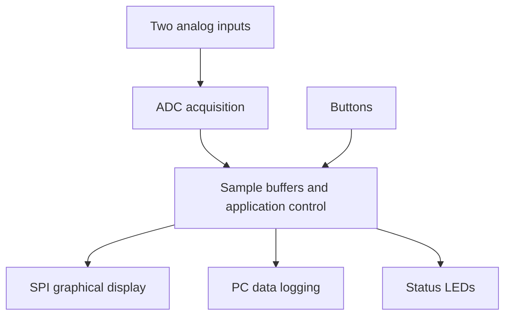

# STM32 Embedded Oscilloscope

**A two-channel oscilloscope project exploring embedded C, STM32 peripheral configuration, SPI display communication, and hardware prototyping.**

**Platform:** STM32 NUCLEO-L432KC  
**Status:** In development

## Overview

I am developing an STM32-based oscilloscope to build practical experience taking an embedded system from requirements and schematic planning to firmware implementation and a working development-board prototype. The intended system acquires two analog input channels, displays one selected channel on a graphical LCD, and supports user controls and data recording to a PC.

My focus is understanding how the system works across hardware and software: how an analog signal becomes a digital sample, how firmware schedules acquisition and display updates, how the MCU communicates with external devices, and how measurements can verify that the implementation behaves as intended.

The final project deliverable is a **Nucleo-based prototype**. A proposed standalone MCU schematic and bill of materials support my study of the circuitry required to move beyond a development board. PCB layout, fabrication, assembly, and validation of a custom board are outside this project's scope.

> **Development status:** Features below describe the intended implementation unless explicitly supported by measured results. Demo media, final configuration values, and validation data will be added as the prototype reaches those milestones.

## Prototype and Demonstration

| Evidence | Publication status |
| --- | --- |
| Complete prototype photograph | To be added following hardware integration |
| Video demonstration | Planned following functional validation |
| LCD waveform demonstration | To be added with a documented input signal |
| PC recording example | To be added following logging integration |
| Logic-analyzer captures | To be added during interface verification |
| Performance measurements | Pending bench validation |

<!-- Add a photograph here when available:  -->
<!-- Add a demo video link here when published. -->

The demonstration will show the physical setup, input signal, channel selection, displayed waveform, recording controls, and measured limitations.

## Hands-On Engineering Focus

| Area | Concepts I am applying | Evidence planned for this repository |
| --- | --- | --- |
| Embedded C | Modular code, pointers and buffers, peripheral drivers, state management, and hardware/software interaction | Application source and documented module responsibilities |
| STM32CubeMX | Pin multiplexing, clock configuration, peripheral setup, interrupt configuration, and generated initialization code | `.ioc` file and configuration rationale |
| Analog acquisition | ADC configuration, sampling timing, channel sequencing, voltage conversion, and input limitations | Acquisition code and known-signal measurements |
| SPI communication | Clock polarity/phase, clock rate, chip select, command/data handling, and transaction timing | LCD driver and decoded bus captures |
| Firmware architecture | Polling versus interrupts, bounded interrupt work, buffering, and coordinating acquisition with slower output tasks | Architecture notes and timing observations |
| User interface | GPIO inputs/outputs, button debouncing, channel selection, and recording state | Control logic and functional tests |
| PC communication | Data framing, throughput, channel identification, and host-side recording | Interface specification and sample capture |
| Debugging | SWD debugging, breakpoints, variable inspection, and logic-analyzer measurements | Documented debugging examples |
| Hardware design | Reading schematics, component selection, power rails, decoupling, reset/boot circuitry, and programming connections | Prototype wiring, standalone design notes, and BOMs |
| Verification | Translating requirements into repeatable tests and distinguishing targets from results | Test procedures, captures, and measured specifications |

## Scope and Requirements

| Item | Intended behavior | Status / qualification |
| --- | --- | --- |
| Analog channels | Two selectable input channels | Integration and validation ongoing |
| Graphical display | Display one selected channel at a time | Display integration ongoing |
| Input range | Nominal 0–3.3 V, referenced to prototype ground | Actual permissible range and accuracy to be documented |
| Acquisition performance | Establish a repeatable sampling rate and useful input frequency range | Numerical specification pending clarification and measurement |
| PC data recording | Transfer captured samples for host-side logging | Transport and format to be finalized |
| Channel controls | Push buttons for channel activation/selection | Behavior to be verified |
| Recording control | Start/stop recording button | Behavior to be verified |
| Indicators | Power, channel activity, and recording status | Behavior to be verified |
| Physical implementation | Nucleo, external display, and prototype wiring | Final hardware deliverable |
| Standalone hardware | MCU schematic, component selection, and BOM | Design study; not fabricated or hardware-validated |

### Sampling Rate and Bandwidth

The initial reference requirement uses the phrase “accurate to 500 kHz.” This must be resolved into a measurable specification before being treated as an achieved capability.

- **Sampling rate**, measured in samples per second, describes how frequently input values are acquired.
- **Input bandwidth** describes the signal frequency range over which a defined measurement accuracy is maintained.
- **Display refresh rate** describes how frequently the displayed waveform updates.
- **Logging throughput** describes how quickly data reaches the PC.

These values will be reported separately, including whether a sampling rate is per channel or aggregate. Enabling two channels does not, by itself, imply simultaneous sampling. Channel sequencing and any timing offset will be documented. No 500 kHz measurement-bandwidth claim is made at this stage.

## System Architecture

The intended data flow is shown below. Final scheduling and buffering details will be documented alongside the implementation.

### Acquisition and Buffering

The acquisition path will collect samples, preserve channel identity, and make data available to the display and recording paths. The firmware design considers how to avoid overwriting samples that are still in use and how to handle consumers that cannot keep up with acquisition.

The final ADC trigger source, channel sequence, buffer sizes, and transfer method—polling, interrupt-driven transfers, or DMA—will be recorded with the tested firmware revision. These are implementation decisions to verify, rather than assumed completed features.

### Display and Application Control

The display path will convert sample values into waveform coordinates and communicate with the LCD over SPI. I am working on separating display-specific commands from application behavior so that acquisition, channel selection, and recording logic remain understandable and maintainable.

Button handling will include software debouncing and defined state transitions. The architecture will keep time-sensitive work short and place longer operations, such as rendering or formatting output, where they do not unnecessarily delay acquisition.

### PC Recording

The PC interface will have a documented format defining channel identification, sample representation, and timing information. The final transport will be identified explicitly: UART through a virtual COM connection and native USB on the target MCU are distinct implementations. USB power alone will not be presented as USB data-protocol implementation.

## Hardware

### Nucleo Prototype

The prototype combines the STM32 NUCLEO-L432KC with a graphical LCD, two analog input connections, push buttons, and status indicators. The prototype documentation will identify exact header pins, MCU pin names, power connections, and component values.

The reference design specifies an ERM19296-1 graphical LCD using an ST75256 controller. The exact module variant, interface configuration, and prototype wiring will be confirmed in the prototype BOM and pin map.

| Connection group | Documentation to be added |
| --- | --- |
| Analog inputs | MCU pins, channel assignment, input limits, and ground connection |
| LCD | SPI clock/data pins, chip select, command/data selection, reset, and power |
| Controls | Button pins, active levels, pull resistors, and debounce behavior |
| Indicators | GPIO assignments, resistor values, and status meanings |
| PC interface | Physical path, peripheral settings, and host connection |
| Debugging | Programming/debug connection and relevant board configuration |

### Standalone Hardware Design Study

The standalone schematic is used to understand the supporting circuitry that a development board normally supplies. Design notes will explain:

- MCU selection and required peripheral/pin availability.
- Supply regulation and power distribution.
- Local decoupling and analog supply considerations.
- Reset and boot configuration.
- SWD programming/debug access.
- LCD power and interface connections.
- Button biasing and LED current-limiting resistors.
- Signal connectors and analog input considerations.
- Differences between the development-board prototype and standalone implementation.

The prototype and standalone BOMs will be maintained separately because they represent different assemblies. Schematic preparation demonstrates circuit-design reasoning; placement, routing, manufacturing checks, and fabricated-board bring-up are not claimed as completed work.

### Input Limitations

This prototype is intended for controlled, low-voltage laboratory signals within the documented ADC input limits. The reference schematic routes inputs directly to ADC nets; the prototype should not be assumed to provide attenuation, negative-voltage handling, isolation, or overvoltage protection. Any input conditioning added during development will be documented and tested.

## Firmware and Tooling

| Component | Role | Documentation status |
| --- | --- | --- |
| C | Application logic and peripheral integration | Source to be documented with implementation |
| STM32CubeMX | Pin, clock, and peripheral configuration | `.ioc` to accompany the firmware |
| STM32 development/build environment | Build, flash, and debug | Exact tools and versions to be recorded |
| STM32 HAL/CMSIS, where used | Device support and peripheral access | Used package versions to be recorded |
| LCD driver | Display initialization, commands, and pixel updates | Implementation and attribution to be documented |
| Host-side logging utility | Receive and save captured samples | To be added with the PC interface |
| Logic analyzer | Observe and decode digital transactions | Captures to be added during verification |

I am using generated initialization code as a starting point while working to understand the underlying configuration and its effect on system behavior. Application code and adapted third-party code will be identified separately from generated support files.

## Repository Organization

The following is the intended organization as supporting files are added. Paths listed here are a documentation plan, not a claim that every file is already present.

| Location | Purpose |
| --- | --- |
| `firmware/` | CubeMX configuration, C source, required dependencies, and build files |
| `hardware/prototype/` | Actual wiring, pin map, and prototype BOM |
| `hardware/standalone/` | Proposed schematic, standalone BOM, and design notes |
| `docs/` | Requirements, architecture, interface details, and operating instructions |
| `tests/` | Test plan, results, and measurement captures |
| `tools/` | Host-side acquisition or plotting utilities, if implemented |
| `data/examples/` | Short example recordings and format descriptions |
| `media/` | Prototype photographs, screenshots, and demonstration assets |

## Build, Flash, and Operate

> **Reproduction guide:** Detailed instructions will be published after the firmware builds and runs successfully from a clean checkout. Exact commands, tool versions, and pin assignments are pending validation.

The documented workflow will cover:

1. Obtain the source and install the recorded toolchain/dependencies.
2. Open the project and inspect the supplied CubeMX configuration.
3. Assemble the prototype using the verified wiring diagram and pin map.
4. Build and flash the firmware through the board's programming/debug interface.
5. Confirm startup behavior, display initialization, and indicators.
6. Connect a known input signal within the documented limits.
7. Select a channel and observe the waveform.
8. Start and stop PC recording using the documented host utility and controls.

The final guide will include expected behavior and troubleshooting steps for failed display initialization, missing samples, and host communication issues.

## Verification Plan

| Test | What it establishes | Status |
| --- | --- | --- |
| Known DC inputs | ADC conversion and voltage-scaling accuracy | Planned |
| Known periodic waveform | Displayed amplitude and time-axis behavior | Planned |
| Two-channel operation | Channel identity, selection, and sequencing | Planned |
| Sampling timing | Actual rate and timing consistency under defined conditions | Planned |
| SPI transaction capture | Display command/data sequencing and bus settings | Planned |
| Button operation | Debouncing and intended state transitions | Planned |
| Recording start/stop | Correct capture boundaries and status indication | Planned |
| PC data integrity | Sample ordering, format, and loss behavior | Planned |
| Concurrent operation | Interaction between acquisition, display, and logging | Planned |
| Extended run | Buffer handling and sustained operation | Planned |

Test records will include the firmware commit, input conditions, equipment/setup, expected behavior, observed result, and supporting evidence.

### Measured Performance

| Metric | Result |
| --- | --- |
| Sampling rate: one channel | Pending measurement |
| Sampling rate: two channels | Pending measurement; per-channel and aggregate rates to be reported |
| Channel-to-channel sampling offset | Pending characterization |
| Voltage measurement error | Pending measurement |
| Useful input frequency range | Pending a defined accuracy criterion and frequency testing |
| Display refresh rate | Pending measurement |
| Sustained PC logging throughput | Pending measurement |
| Sample loss / buffer overflow behavior | Pending testing |

## Engineering Decisions and Debugging

I will document the reasoning behind the implementation, including how I balance acquisition timing, display responsiveness, memory use, and communication throughput.

Topics being investigated include:

- Where polling is sufficient and where interrupts or DMA provide a practical benefit.
- How to coordinate access to shared buffers.
- How LCD updates affect the time available for acquisition and logging.
- How ADC configuration and channel sequencing affect the captured signal.
- How to make recording state and data loss observable.
- Which hardware assumptions change when moving from a Nucleo to a standalone MCU.

Debugging examples will record the symptom, hypothesis, measurement, root cause, correction, and verification. **First documented case study: to be added after a reproducible issue has been investigated and resolved.**

## Development Milestones

- [ ] Finalize measurable requirements and prototype pin assignments.
- [ ] Bring up the LCD, buttons, and indicators.
- [ ] Validate acquisition using known input signals.
- [ ] Integrate channel selection and waveform rendering.
- [ ] Implement and verify PC recording.
- [ ] Characterize timing, accuracy, and sustained operation.
- [ ] Document standalone schematic decisions and unresolved design issues.
- [ ] Publish reproducible build instructions and a demonstration.

Milestones are marked complete only when their implementation and supporting evidence are available. Custom PCB fabrication is outside the planned completion criteria.

## References

My focus is the hands-on process of configuring the STM32, developing and understanding the C firmware, integrating the prototype, investigating failures, and validating behavior. Specific changes and independently implemented features will be described alongside their source and test evidence as development progresses.

| NUCLEO-L432KC board documentation | Exact document revision/link to be added |
| STM32L432 device datasheet and reference manual | Revisions used during implementation to be recorded |
| LCD module and ST75256 controller documentation | Exact module documentation/revision to be added |
| Reused libraries or driver code | Source, modifications, and license notices to accompany the code |

